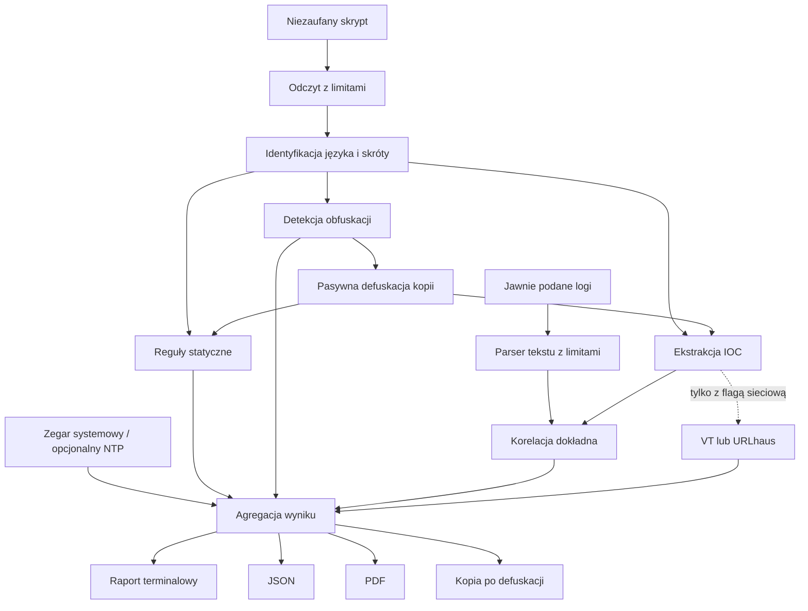

# Architektura

## Kontekst

Infa-Sled jest jednopunktowym programem CLI działającym lokalnie. Jego granicą
zaufania jest proces Pythona: plik skryptu i logi są niezaufanymi danymi, a
katalog wynikowy jest jedynym miejscem zapisu. Rdzeń nie wymaga usług ani bazy
danych.

## Przepływ danych

## Moduły

| Moduł | Odpowiedzialność | Wejście | Wyjście |
|---|---|---|---|
| `config.py` | walidacja konfiguracji i bramki sieciowej | wartości CLI | `AnalysisConfig` |
| `fileio.py` | limitowany odczyt, kodowanie, język, skróty | ścieżka | `ScriptInput` |
| `rules.py` | deterministyczne reguły podejrzanego kodu | tekst, język | `Finding[]` |
| `obfuscation.py` | sygnały i bezpieczne transformacje literałów | tekst | sygnały, kopia, transformacje |
| `ioc.py` | URL, domeny, IPv4 i normalizacja | tekst | `IOC[]` |
| `connections.py` | odczyt logów i korelacja | logi, IOC | `ConnectionMatch[]` |
| `timing.py` | UTC i opcjonalny NTP | konfiguracja | `TimestampInfo` |
| `reputation.py` | opcjonalny odczyt reputacji | IOC | `ReputationResult[]` |
| `pipeline.py` | kolejność etapów i odporność | plik, konfiguracja | `AnalysisResult` |
| `reporting.py` | prezentacja, serializacja i atomowy zapis | wynik | terminal, JSON, PDF, tekst |
| `cli.py` | interfejs użytkownika i kody wyjścia | argumenty | komunikaty i artefakty |
| `models.py` | kontrakty między modułami | - | dataclasses |

## Kontrakty

- `AnalysisResult.schema_version` ma obecnie wartość `1.0`.
- Kolekcje w modelach są krotkami, co ogranicza przypadkową mutację.
- Każda detekcja ma stabilny `rule_id`, ważność, linię i fragment dowodu.
- IOC przechowuje pochodzenie: `original`, `deobfuscated` lub
  `connection-log`.
- Wyniki pośrednie i raporty nigdy nie nadpisują źródła.

## Rozszerzalność

Nowy język wymaga: mapy rozszerzeń i heurystyk w `fileio.py`, reguł z testami,
aktualizacji ekstrakcji/defuskacji, testu integracyjnego i aktualizacji macierzy
wymagań. Zewnętrzny silnik analizy powinien być osobnym adapterem zwracającym
modele `Finding`; musi działać z `shell=False`, limitem czasu i ograniczonym
wyjściem. Decyzja o braku obowiązkowych adapterów zewnętrznych jest opisana w
`docs/decisions/0001-standard-library-core.md`.
