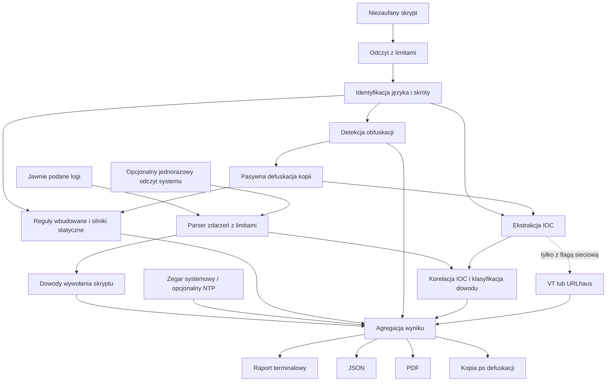

# Architektura

## Kontekst

ScriptScanner jest lokalnym analizatorem plików. Granicą zaufania jest proces
Pythona: plik skryptu i jawnie podane logi są niezaufanymi danymi, a katalog
wynikowy jest jedynym miejscem zapisu. Rdzeń nie wymaga usług ani bazy danych.

## Przepływ danych

## Moduły

| Moduł | Odpowiedzialność | Wejście | Wyjście |
|---|---|---|---|
| `config.py` | walidacja konfiguracji i bramki sieciowej | wartości CLI | `AnalysisConfig` |
| `fileio.py` | limitowany odczyt, kodowanie, język, skróty | ścieżka | `ScriptInput` |
| `rules.py` | deterministyczne reguły podejrzanego kodu | tekst, język | `Finding[]` |
| `engines.py`, `engine_rules.py` | uruchomienie lokalnych silników, reguły i mapowanie wyników | bajty, tekst, język, katalog wyjściowy | `Finding[]`, `EngineRun[]` |
| `obfuscation.py` | sygnały i bezpieczne transformacje literałów | tekst | sygnały, kopia, transformacje |
| `ioc.py` | URL, domeny, IPv4 i normalizacja | tekst | `IOC[]` |
| `sanitization.py` | rozbrajanie URL, domen i IPv4/IPv6 przed wyjściem | tekst/struktura | bezpieczna prezentacja |
| `connections.py` | odczyt logów, korelacja i status każdego IOC | logi, IOC | `ConnectionCheck[]`, `ConnectionMatch[]` |
| `history.py` | import XML/JSONL/CSV/Audit, adaptery systemu, identyfikacja wywołania | pliki lub jawny odczyt OS | `HistoryEvent[]`, `HistorySource[]`, `ExecutionCheck` |
| `timing.py` | UTC i opcjonalny NTP | konfiguracja | `TimestampInfo` |
| `reputation.py` | opcjonalny odczyt reputacji | IOC | `ReputationResult[]` |
| `pipeline.py` | kolejność etapów, odporność i callback postępu | plik, konfiguracja | `AnalysisResult` |
| `reporting.py` | prezentacja, serializacja i atomowy zapis | wynik | terminal, JSON, PDF, tekst |
| `main.py` | główny interfejs użytkownika i kody wyjścia | argumenty | komunikaty i artefakty |
| `models.py` | kontrakty między modułami | - | dataclasses |

## Kontrakty

- `AnalysisResult.schema_version` ma wartość `1.3`. Pole `engine_runs`
  zawiera nazwę silnika, reprezentację (`original` lub `deobfuscated`),
  status (`ok`, `partial`, `unavailable`, `skipped`, `error`) i opis.
- YARA dostaje bajty źródła, a parsery i lintery dostają tekst UTF-8.
  Po transformacjach silniki otrzymują osobny przebieg na kopii. Dopasowania
  pochodzące wyłącznie z tej kopii mają tag `deobfuscated`. Dopasowania
  plikowe YARA używają linii 1 jako umownego odnośnika.
- Defuskacja zachowuje sekwencje zapisu jednostek zastępczych UTF-16
  w formie `\uNNNN`, dzięki czemu kopia ma poprawne kodowanie UTF-8.
- Kolekcje w modelach są krotkami, co ogranicza przypadkową mutację.
- Każda detekcja ma stabilny `rule_id`, ważność, linię i fragment dowodu.
- IOC przechowuje pochodzenie: `original`, `deobfuscated` lub
  `connection-log`.
- Wyniki pośrednie i raporty nigdy nie nadpisują źródła.
- Domyślny katalog wynikowy to `raport/`; pliki raportów to `raport.json` i `raport.pdf`.
- `ConnectionCheck.status` rozróżnia połączenie, URL request, DNS, zezwolenie,
  blokadę, host URL i wzmiankę. Pełny kontrakt opisuje `CONNECTION_CORRELATION.md`.
- `execution_check` zawiera dowody wywołania skryptu po ścieżce lub hashu skryptu.
  `history_sources` opisuje pokrycie źródeł i błędy. Brak zdarzeń odpowiedniego
  rodzaju oznacza `not-checked`, a nie negatywny wynik historyczny.
- Powiązanie sieci z wywołaniem skryptu wymaga hosta i `ProcessGuid`; surowe PID
  nie są używane do tego celu. Dopasowanie hosta URL nie potwierdza całego URL.
- Postęp sześciu etapów jest emitowany podczas analizy przez opcjonalny callback
  i prezentowany przez `main.py` przed końcowym wynikiem; nie jest częścią
  raportu terminalowego ani plikowego.
- Surowe IOC istnieją tylko w modelu roboczym. Granica wyjściowa rozbraja je do
  `hxxp(s)`, `[.]` i `[:]`; parser wejściowy normalizuje te znaczniki tylko w
  pamięci, aby zachować możliwość korelacji.

## Rozszerzalność

Nowy język wymaga: mapy rozszerzeń i heurystyk w `fileio.py`, reguł z testami,
aktualizacji ekstrakcji/defuskacji, testu integracyjnego i aktualizacji macierzy
wymagań. Zewnętrzny silnik analizy powinien być osobnym adapterem zwracającym
modele `Finding`; musi działać z `shell=False`, limitem czasu i ograniczonym
wyjściem. Decyzja o braku obowiązkowych adapterów zewnętrznych jest opisana w
`docs/decisions/0005-local-static-engines.md`.
